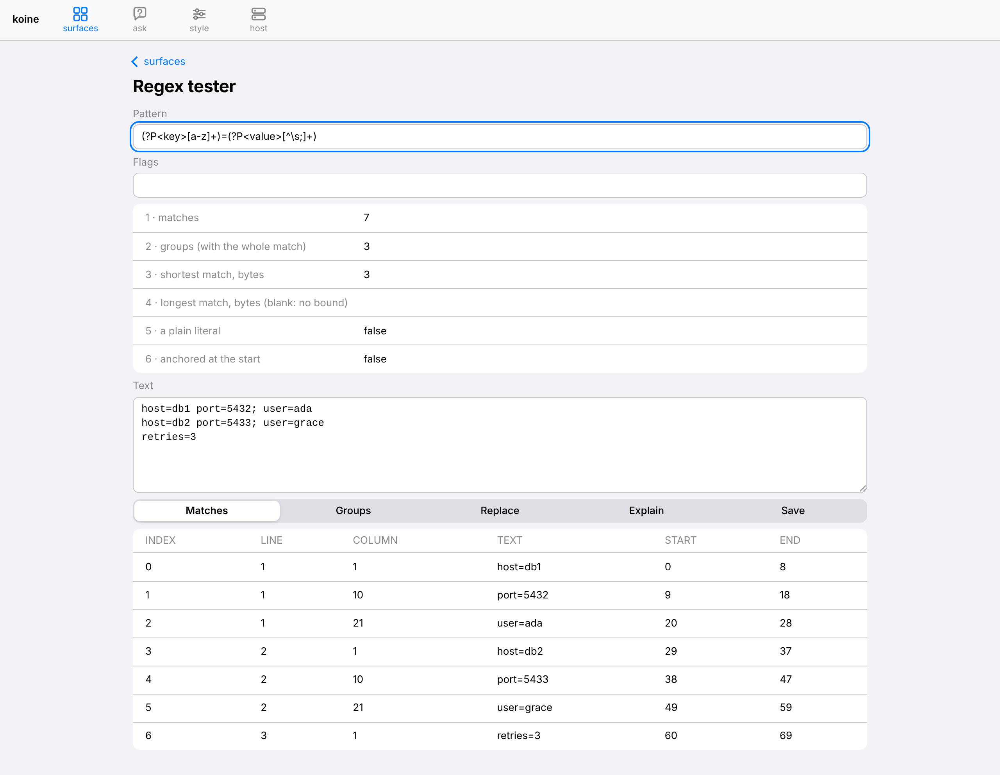

# regex-lab

The [`regex`](https://crates.io/crates/regex) crate as a koine app: 14 verbs,
each one MCP tool, one CLI subcommand, one agent tool and one generated form,
from one `#[impress_method]`. It also has two pages of its own, shipped in the
binary as a package, and a registry with one more package. It is koine's
worked example of wrapping a library, scaffolded with `scripts/new-app.sh
regex-lab --lib regex` and then written out.



## Run it

```bash
cd apps/regex-lab
cargo test                                   # 29 service tests + 3 package tests
cargo run -p regex-lab-host -- --check       # 110 verbs, the package installed
(cd ../../crates/koine-web && dx build --platform web --release)
cargo run -p regex-lab-host -- \
    --web-dir ../../target/dx/koine-web/release/web/public --registry ./registry
# http://localhost:23130/ui/
```

## The verbs

All are `regex-lab-service_<verb>`. The matching verbs take the pattern as
`pattern` or as `saved` (a saved pattern's name), and `flags` as letters
(`imsxUR`, plus `a` for ASCII-only classes).

| verb | what it answers |
|---|---|
| `check` | whether the pattern compiles; its groups, shortest and longest match, literal, anchored |
| `explain` | the pattern's syntax, one row per part, in words |
| `is-match`, `find`, `find-all` | yes or no and where the shortest match ends; the first match; every match, with line and column |
| `captures`, `captures-all` | groups of the first or of every match, as rows and as one record per match |
| `replace`, `split` | `$1`/`${name}` expansion or `literal`, with a count; pieces with offsets |
| `set-matches` | which of several patterns match, in one pass |
| `escape` | the pattern that matches a text exactly |
| `save-pattern`, `patterns`, `delete-pattern` | the library: `regex-pattern` records in the host's store |

A pattern that does not parse is refused `invalid-pattern` with `at` (line
and column in the pattern) and `diagram`. Both come from running
`regex-syntax` on its own, because `regex` reports a syntax error only as
text. Compiled patterns are kept in a bounded cache, so the tester re-runs
five verbs per keystroke but compiles the pattern only once.

`scripts/check-verb-coverage.sh --lib <regex> --service
crates/regex-lab-service` (koine's) covers 64 public items of `regex`. The
other 9 are excluded, each with its reason, in
`crates/regex-lab-service/verb-exclusions.toml`: the bytes-only
`Match::as_bytes`, the nightly `Pattern` searcher, and the
`CaptureLocations` buffer-reuse API. The report is
[`docs/verb-coverage.txt`](docs/verb-coverage.txt).

## The packages

- **`package/`, built in.** It holds the *Regex tester* (one pattern and text
  through `check`, `find-all`, `captures-all`, `replace` and `explain`) and
  the *Pattern library*, plus a skill. `crates/regex-lab-host/src/package.rs`
  embeds it, and `koine_host::cli::main_configured` adds it to
  `Config::packages`. The host installs it at start, three-way, so a
  person's edit to a page survives an upgrade.
- **`registry/`, a package registry.** Its one package is `regex-recipes`:
  DOI, arXiv id, ISO date, semver, email, URL, IPv4, UUID and log-line
  patterns, saved into the library with one button, and a *Log fields* page
  that turns log lines into a table. Install it from the Packages page, or
  with `package-service_fetch` (the review) and then `package-service_install`.
  Republish it after a change:

  ```bash
  cargo run -p regex-lab-host -- package bundle registry/src/regex-recipes \
      --out registry --index registry/index.json --registry-name regex-lab
  ```

The library page needs no refresh wiring. Its `patterns` source declares
`reads: ["regex-pattern"]`, so a save or a delete re-runs it.

## What it costs

These are measured against the scaffold (one `echo` verb) and against the
same app built with every `koine-host` default (docs/plan-koine-host.md
H-D10). Crates are counted with `cargo tree -e normal`.

| build | crates | verbs | release binary |
|---|---|---|---|
| scaffold, every koine-host default | 194 | 118 | 32 MB |
| scaffold, `default-features = false` | 164 | 97 | 25 MB |
| regex-lab, `default-features = false` | 164 | 110 | 27 MB |

`regex` and `regex-syntax` were already in the tree, so the app adds no
crate, and its 14 verbs add 2 MB. The 96 verbs that are not the app's are the
runtime and the kit: layout, surfaces, the notebook, the agent desk and
packages.

Lines written by hand:

- **Rust, without tests: 2,160.** Of these, `service.rs` has 870 lines, and
  155 of them are the `methods = [...]` list that
  `impress_service_impl!` needs repeated. The host is 55 lines.
- **Tests: 545.**
- **Pages: 602 lines of surface JSON** across both packages.
- **HTML, CSS, JavaScript or Swift: 0.**

The app needed three things koine did not have, and koine has them now:

- `cli::main_configured`, so a host binary can add its own packages.
- `{"text": {"multiline": true}}`, a textarea field.
- Generated forms that show a refusable result's rows as tables. A result
  like `{ok, count, pieces: [...]}` used to render as raw JSON.

## Screenshots

`scripts/screenshots.mjs` walks through the app against a running host and
writes `docs/screenshots/regex-lab-*.png`:

1. the tester;
2. a refused pattern, with its place marked;
3. the explanation;
4. replace;
5. the surfaces after the registry install;
6. the recipes;
7. the library, trying `arxiv-id`;
8. log fields;
9. the generated form for `split`;
10. the tester on a phone, in dark mode.

```bash
REGEX_LAB_TOKEN_FILE=<workspace>/automation/loopback-<port>.token \
REGEX_LAB_URL=http://127.0.0.1:<port> node scripts/screenshots.mjs
```
